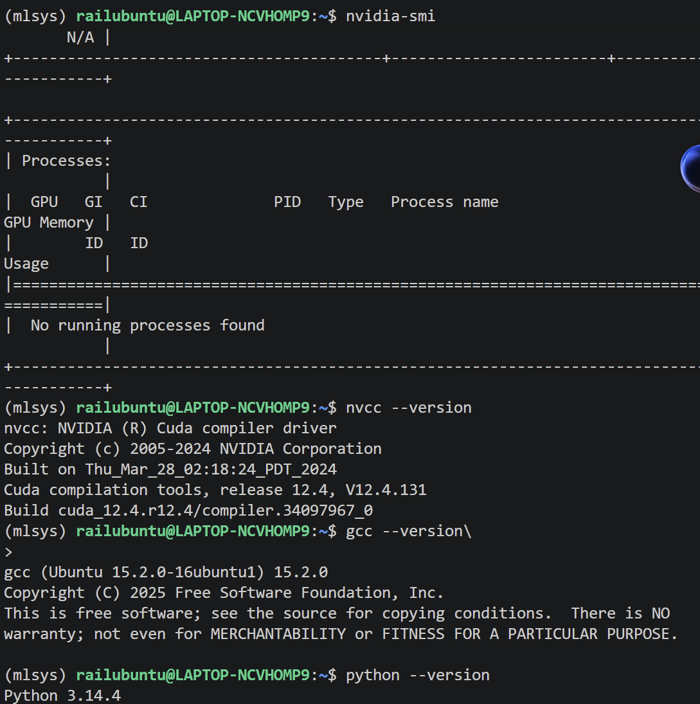

#### 环境配置

###### 环境配置结果记录

###### 问题

1 .
GPU Driver,即显卡驱动，直接接触硬件，负责管理GPU和翻译指令，
进行内存管理、调度、翻译、隔离等工作。
CUDA Toolkit是一整套开发工具链，包含有nvcc编译器，库函数，头文件，调试工具，头文件，CUDA Runtime库等。是开发必备。
PyTorch CUDA Runtime是与pytorch捆绑下载的一个CUDA库集合，可以被pytorch调用去通过Driver API操作GPU。
三者关系：GPU Driver是一切的底层，其余两者都需要与它沟通来操作GPU。CUDA toolkit 的出现是为了更方便的使用显卡驱动，提供了一整套开发工具，供开发者手写CCUDA代码，编译自定义GPU 算子。PyTorch CUDA Runtime是Pytorch内含的一个CUDA动态库，受PyTorch的直接调用以操纵GPU。
2.
nvcc是CUDA编译器驱动，是CUDA Toolkit的组件，作用是把.cu文件编译成可执行文件。它会将host代码转交主机编译器编译，将device代码交给GPU汇编器编译，并且把生成的.o文件与cudart链接，最后与GPU二进制文件打包生成可执行文件。nvcc在CUDA Toolkit安装包里面。
nvidia-smi是显卡驱动自带的一个用户查询工具，可以读取驱动维护的GPU状态信息，如利用率、显存占用、温度、正在占用GPU的进程等。在驱动安装包里面。
所以，二者位于两个相互独立的安装包，安装了其中一个不能代表另一个也存在。
3.
动态链接库是一种代码库，与之前信息的gcc中的链接不同，它并不会被复制到可执行文件里面（也就是静态链接），而是在运行期间才被加载进内存，且可以被多个进程共享。程序运行时，操作系统会先启动动态链接器，读取可执行文件里的依赖清单，找到对应的.so文件，将.so文件的代码加载进内存，再把可执行文件中的调用地址只想真正的函数地址，完成连接。库在内存之中只加载一次。
4.
shell会根据PATH去找可执行文件，找到之后就执行，是执行命令的途径。
而动态链接器会根据LD_LIBRARY_PATH和其他目录去找动态库，方便后续把它加载进内存。
5.
使用python 虚拟环境可以隔离不同项目的Python 第三方包，解决包版本冲突的问题，使各个项目都能使用对应版本的Python

